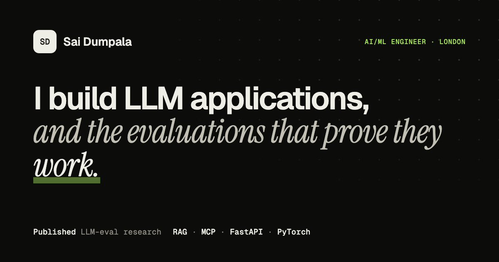

# Sai Dumpala, portfolio

Personal site for **Sai Dumpala**, AI/ML engineer in London: LLM applications, and the evaluations that show whether they work.

**Live:** https://saidumpala01.github.io/portfolio/ (after GitHub Pages is enabled, see below)



## What's on it

| Section | Content | Source of truth |
|---|---|---|
| Hero | Headline, availability, terminal replaying real CLI output | Project READMEs |
| Selected work | sixdim-eval, ResuMetric, docs-rag-eval, uk-visa-sponsor-mcp, pneumonia CNN audit, with live CI badges | Each repository's README |
| Research | The Zenodo paper, an interactive chart of Experiment 1, three key findings | `LLm-Evaluation-framework/paper/data/*.csv` |
| How I work | Four engineering principles, each linked to evidence | Project READMEs |
| Experience | Mercor, Outlier AI, hibretOne-CIC, MSc, BSc, certifications | LinkedIn |
| Toolkit / Contact | Skills used in the projects; email, LinkedIn, GitHub, ORCID, Scholar, Zenodo | CV, GitHub profile |

Every number on the site comes from a public source above. The withdrawn MSc figures (96.2% accuracy, AUC 0.977) are deliberately **not** quoted, in line with [`results-audit.md`](https://github.com/SAIDUMPALA01/medical-image-classification-system1/blob/main/docs/results-audit.md).

## Design

- Plain HTML, CSS and JavaScript. No framework, no build step, no trackers, no cookies.
- Light and dark themes (follows the OS, with a toggle that remembers the choice).
- First-visit intro that "runs" the six evaluation dimensions, an interactive dot field in the hero, staggered reveals, count-up stats and card spotlights. All motion is switched off for visitors who set *reduce motion*.
- `⌘K` / `Ctrl+K` quick navigation.
- Accessible: semantic landmarks, skip link, keyboard-operable tabs and palette, chart with a table view, visible focus rings.
- SEO: Open Graph and Twitter cards, `Person` JSON-LD, sitemap and robots.txt.
- Prints as a clean one-pager (`Cmd+P`).

```
index.html            the whole page
assets/css/style.css  design tokens (top of file), layout, motion, print styles
assets/js/main.js     theme, intro, terminal replay, chart, quick navigation
assets/img/           favicon, social preview, project screenshots
404.html              not-found page
.github/workflows/    asset check + GitHub Pages deploy
```

## Run it locally

```bash
python3 -m http.server 4173
# open http://localhost:4173
```

## Deploy (GitHub Pages)

1. Merge this branch into `main`.
2. In the repository: **Settings → Pages → Build and deployment → Source: GitHub Actions**.
3. Every push to `main` runs `.github/workflows/deploy.yml`, which checks that every referenced asset exists and then deploys to the `github-pages` environment.

If you later use a custom domain, update the `canonical`, `og:url` and `og:image` URLs in `index.html`, plus `robots.txt` and `sitemap.xml`.

## Updating content

- **Text:** edit `index.html`; each section is marked with a comment banner.
- **Colours:** change the tokens at the top of `assets/css/style.css` (light block, then the two dark blocks).
- **Terminal replay:** the `SCRIPTS` array in `assets/js/main.js`.
- **Chart data:** the `DATA` array in `assets/js/main.js`, and the matching table in `index.html`.
- **Quick navigation entries:** the `ITEMS` array in `assets/js/main.js`.
